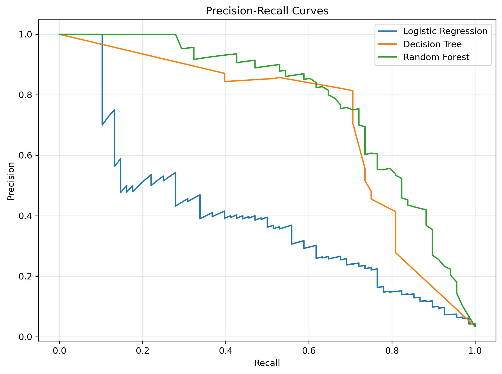
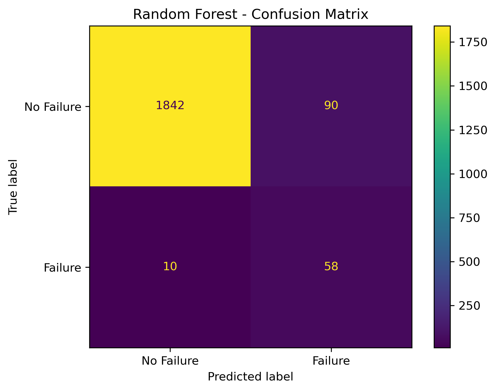
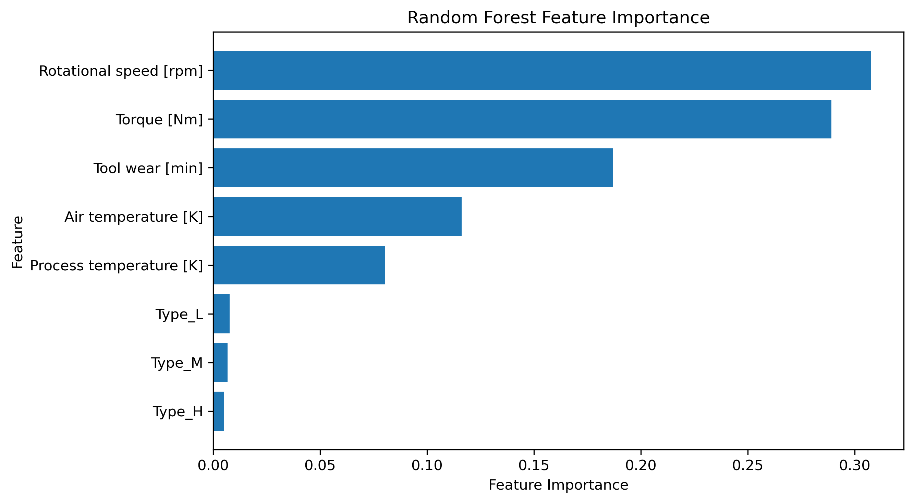

# Industrial Predictive Maintenance

A Python-based machine learning project focused on predicting machine failures using sensor data, classification models, threshold optimization, and model evaluation.

## Project Overview

This project covers exploratory data analysis, data preprocessing, model comparison, decision threshold tuning, and machine failure prediction using the AI4I 2020 Predictive Maintenance Dataset.

## Topics Covered

- Exploratory data analysis and data visualization
- Data preprocessing and feature engineering
- Prevention of target leakage
- Classification using Logistic Regression, Decision Tree, and Random Forest
- Handling class imbalance
- Model evaluation using precision, recall, F1-score, and PR-AUC
- Precision-recall curve analysis
- Decision threshold optimization
- Confusion matrix and error analysis
- Feature importance analysis
- Saving and loading trained models for prediction

## Visualizations

### 1. Precision-Recall Curves


### 2. Tuned Random Forest Confusion Matrix


### 3. Random Forest Feature Importance


## Model Evaluation

The baseline models were compared using multiple classification metrics. After tuning the Random Forest decision threshold to prioritize failure detection, the model achieved the following results on the test set:

- Precision: 0.420
- Recall: 0.882
- F1-score: 0.569
- PR-AUC: 0.773
- Decision threshold: 0.100

The model detected 60 out of 68 failure cases, with 83 false-positive predictions.

## Project Structure

```text
industrial-predictive-maintenance/
├── data/
│   └── ai4i2020.csv
├── notebooks/
│   ├── 01_data_exploration.ipynb
│   ├── 02_data_preprocessing.ipynb
│   └── 03_model_training.ipynb
├── src/
│   ├── data_preprocessing.py
│   ├── train_model.py
│   ├── evaluate_model.py
│   └── predict.py
├── reports/
│   ├── figures/
│   │   ├── precision_recall_curves.png
│   │   ├── random_forest_tuned_confusion_matrix.png
│   │   └── random_forest_feature_importance.png
│   ├── model_comparison.csv
│   ├── tuned_rf_metrics.csv
│   ├── tuned_rf_predictions.csv
│   └── tuned_random_forest.joblib
├── requirements.txt
└── README.md
```

## Technologies

- Python
- Pandas
- NumPy
- Matplotlib
- Seaborn
- scikit-learn
- Joblib
- JupyterLab

## Installation

Clone the repository and install the required dependencies:

```bash
git clone https://github.com/Erfan-innovative-coder/industrial-predictive-maintenance.git
cd industrial-predictive-maintenance
pip install -r requirements.txt
```

## Dataset

This project uses the AI4I 2020 Predictive Maintenance Dataset, which contains simulated industrial sensor measurements and machine failure labels. Results should not be interpreted as validation on real industrial equipment.
